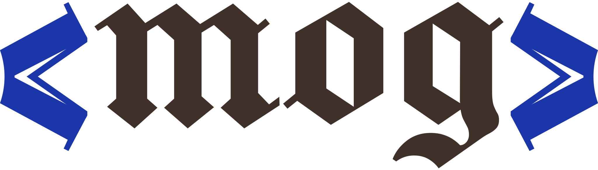

<h1 align="center">
  <picture>
    <source media="(prefers-color-scheme: dark)" srcset="docs/logo-dark.svg">
    
  </picture>
</h1>

A familiar way to structure text.

Mog is a markup language for rich, interconnected documents:
knowledge bases, wikis, and agentic workflows. It draws from Markdown, Org,
and Neorg.

```mog
# Greek salad

::Greek salad::((horiatiki)) needs
ripe tomatoes and __good__ oil,
no more{{ skip the ~~lettuce~~ }}.

##vegetarian:serves=4: Ingredients

#| Item     || Amount ||
-| Tomatoes || 4      ||
-| Feta     || 1 cup  ||

## Method

. Chop the tomatoes.
.. Keep the pieces large.
. Add olives, oil, and feta.
```

## Learn more

- [Specification](https://mog.drake.dev/spec)
- [Reference](https://mog.drake.dev/reference)
- [Playground](https://mog.drake.dev/playground)

The specification written in Mog is kept in in [`packages/parser`](packages/parser).

## Status

The specification is at version 0.2.0. Mog is unstable and subject to change.
